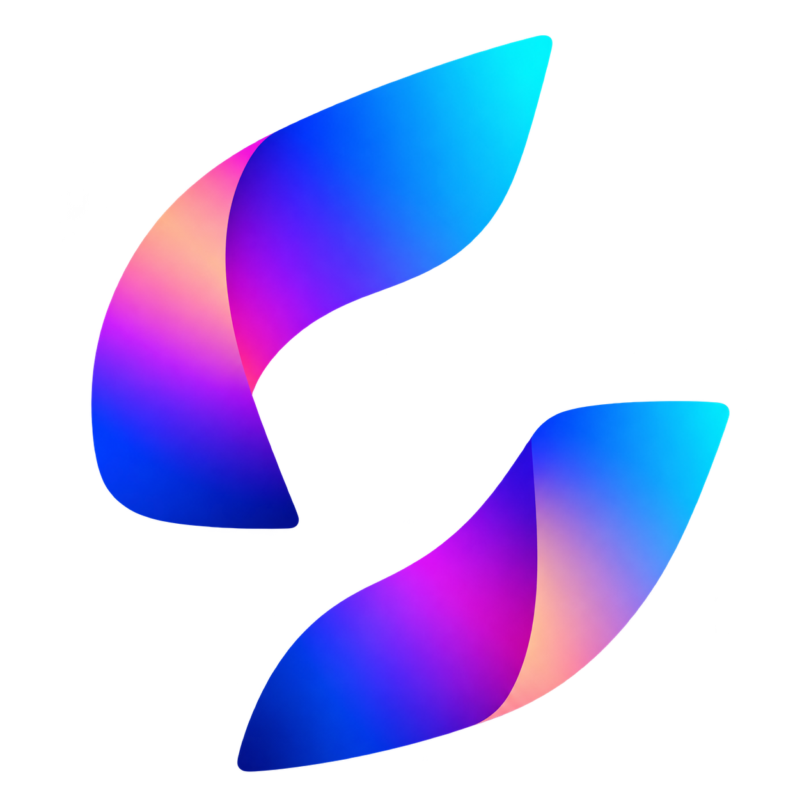
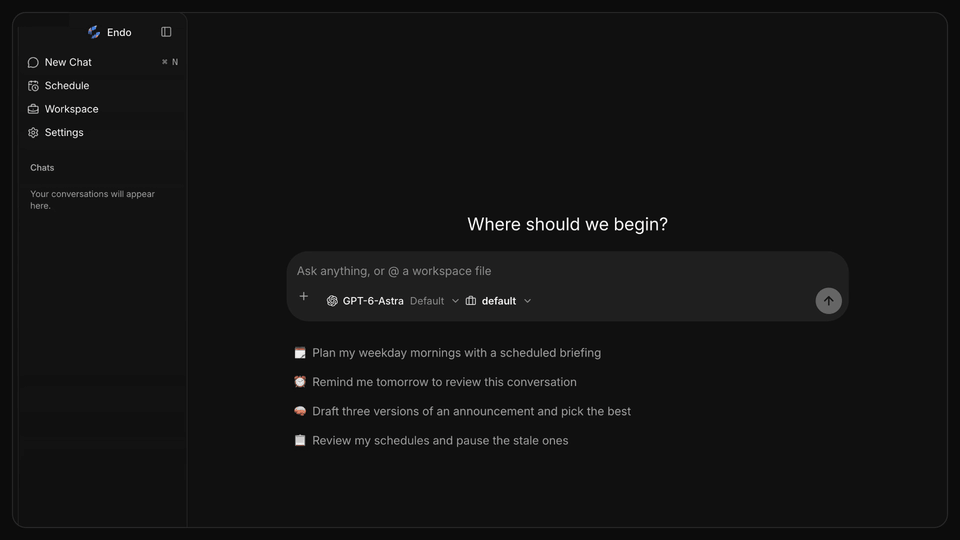
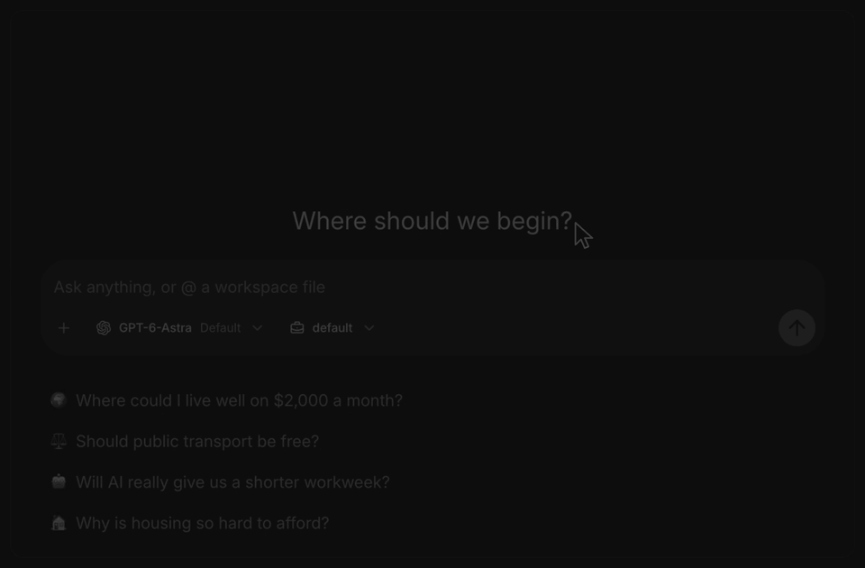
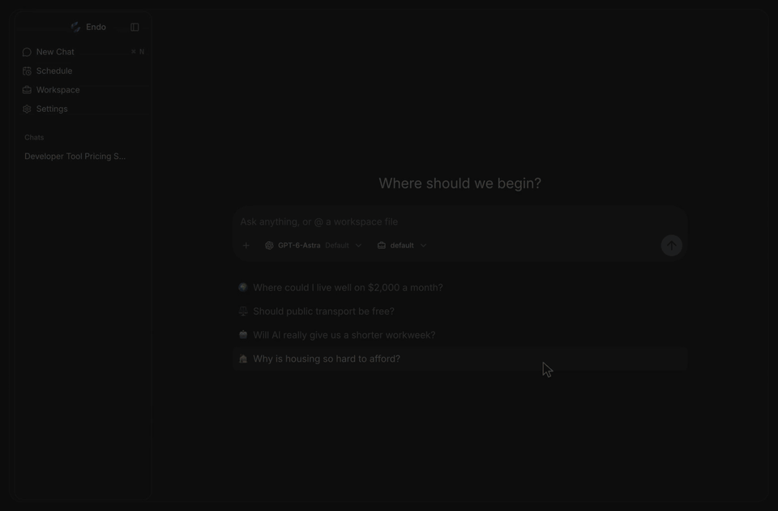
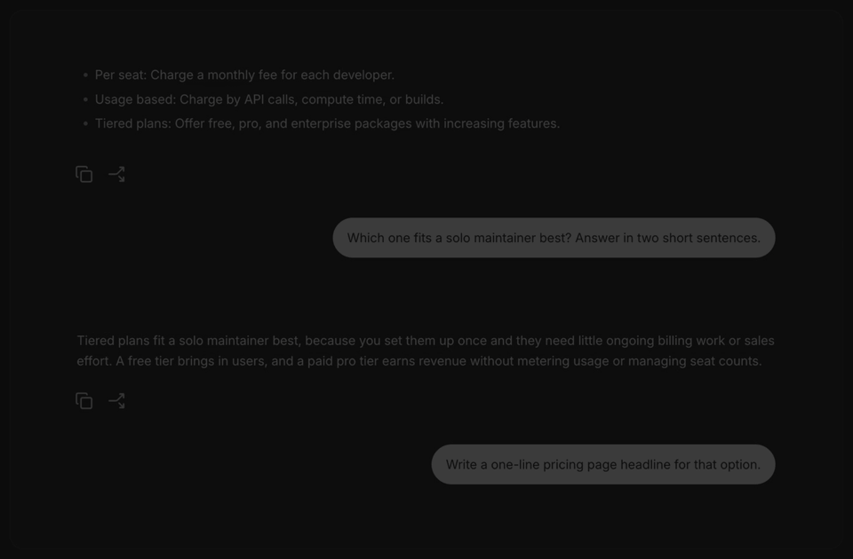
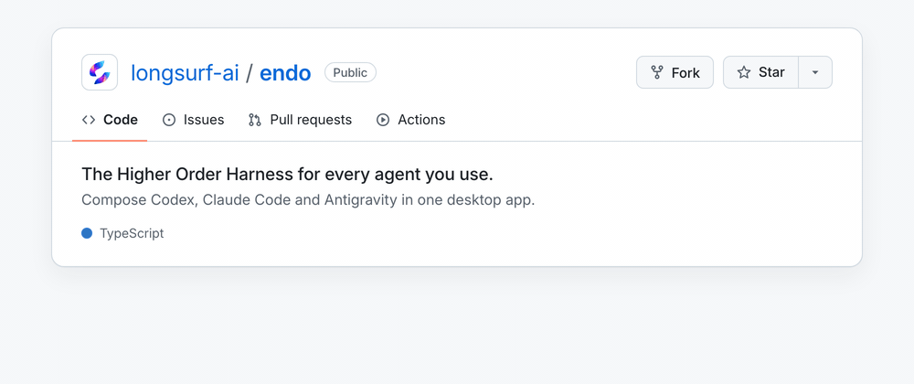

<p align="center">
  
</p>

<h1 align="center">Endo</h1>

<p align="center">
  <b>The Higher Order Harness (HOH).</b><br />
  Compose any agent, on the subscription you already have, into any workflow.
</p>

<p align="center">
  
</p>

<p align="center">
  <a href="https://downloads.longsurf.ai/endo/darwin/arm64/Endo.dmg">Download for Mac</a> ·
  <a href="#quick-start">Quick start</a> ·
  <a href="#key-features">Features</a> ·
  <a href="docs/development.md">Development guide</a>
</p>

<p align="center">
  <a href="https://github.com/longsurf-ai/endo/releases/latest"></a>
  <a href="https://downloads.longsurf.ai/endo/darwin/arm64/Endo.dmg"></a>
  <a href="LICENSE"></a>
  <a href="https://github.com/longsurf-ai/endo/actions/workflows/ci.yml"></a>
</p>

## Higher Order Harness

A harness runs one agent: it sends the prompt, runs the tools and keeps the
history. Endo is a **Higher Order Harness (HOH)**. It takes agents as its
building blocks, the way a higher-order function takes functions, and composes
them freely:

- **In one session**, switch between Codex, Claude Code, Antigravity, Grok and OpenCode
  mid-thread, or Dig In on any answer. Each agent picks up the full history.
- **Across sessions**, a workflow fans work out to agents from different
  vendors and continues any of their sessions, and a schedule runs the whole
  composition again later.

**Why Endo?** The name comes from _endomorphism_, a map whose output is the
same kind of thing as its input. Endo takes agents and gives you back an agent:
every composition answers in a thread you can talk to, dig into and schedule
like any other chat.

## Quick start

[Download Endo for macOS (Apple Silicon)](https://downloads.longsurf.ai/endo/darwin/arm64/Endo.dmg),
open the disk image, and install Endo. Signed releases update themselves in the
background.

To run it from source, install [Node.js 24](https://nodejs.org/en/download),
[Bun 1.4.2](https://bun.sh/docs/installation), and [Just](https://just.systems/man/en/), then:

```sh
git clone https://github.com/longsurf-ai/endo.git
cd endo
just install --frozen-lockfile
just desktop
```

Sign in to at least one provider (an existing `codex`, `claude`, Antigravity or
`grok` login works, or use Settings → Models), or configure
[OpenCode's native model providers](docs/operations/opencode.md). Then ask something like "Every weekday
at 9 AM, summarize my priorities for the day" and open the Schedule page.

## Key features

### Any agent, one protocol, your subscription

Endo drives Codex, Claude Code, Antigravity, Grok and OpenCode natively through their own CLIs.
Use the accounts you already have, or connect compatible endpoints through
OpenCode's native configuration. Settings → Models shows plan usage when the
provider exposes it. Every provider streams
through one protocol into one harness, so answers, tool calls, permission
prompts and history behave the same whichever model you pick, and you can
change it mid-thread.

<p align="center">
  
</p>

### Workflows that compose anything

A workflow is a TypeScript file in your workspace. `agent()` calls any model
from any provider, `parallel()` fans calls out, `phase()` groups them, and a
session ID continues an earlier agent's conversation. Run one from chat and the
Workflow card shows every call as it happens. `/best-of-n`,
`/multi-turn-debate`, `/thesis-killer` and `/hypothesis-race` ship as
workflows, and schedules run any prompt later, on a cron or once.

<p align="center">
  
</p>

### Dig in, one thread, persistent memory

Select any part of an answer and Dig In: a focused conversation opens beside
the thread, and the main thread stays clean. Sessions, runs and Dig Ins persist
on your machine, so after a restart every thread and branch is still there, and
any agent can pick up where another left off.

<p align="center">
  
</p>

## Building on it

- Add user data as a Resource: define it once, as a Drizzle table and an Effect
  Schema, and get a typed API, agent tools and live updates, so people and
  agents change the same state under the same rules. See
  [Adding a Resource](docs/architecture/resource.md#adding-a-resource).
- Add an agent tool in `server/agent/tool/tools/` and register it in
  `server/agent/tool/registry.ts` and `server/agent/profiles/builtin.ts`.
- Change the agent's instructions in `server/agent/profiles/prompt/segments/`.
- Add a page under `app/src/app/` and a feature under `app/src/features/`.
- Build and publish a signed Mac release with the
  [release guide](docs/operations/desktop-release.md).

See the [development guide](docs/development.md) and the
[code organization guide](docs/architecture/code-organization.md). Endo is at
0.1.x, so expect breaking changes.

## Staying updated

[Star Endo](https://github.com/longsurf-ai/endo) to follow releases and help more
people discover it.

[](https://github.com/longsurf-ai/endo)

## License

[MIT](LICENSE)

## Credits

Endo began as the core of [OpenChart](https://github.com/longsurf-ai/openchart).
It credits [Jan](https://www.jan.ai/) for the app's design and visual style,
[OpenCode](https://opencode.ai/) and [Effect](https://effect.website/),
[assistant-ui](https://www.assistant-ui.com/) and [AG-UI](https://docs.ag-ui.com/introduction),
and [shadcn/ui](https://ui.shadcn.com/docs), [Radix UI](https://www.radix-ui.com/primitives),
and [Base UI](https://base-ui.com/).
